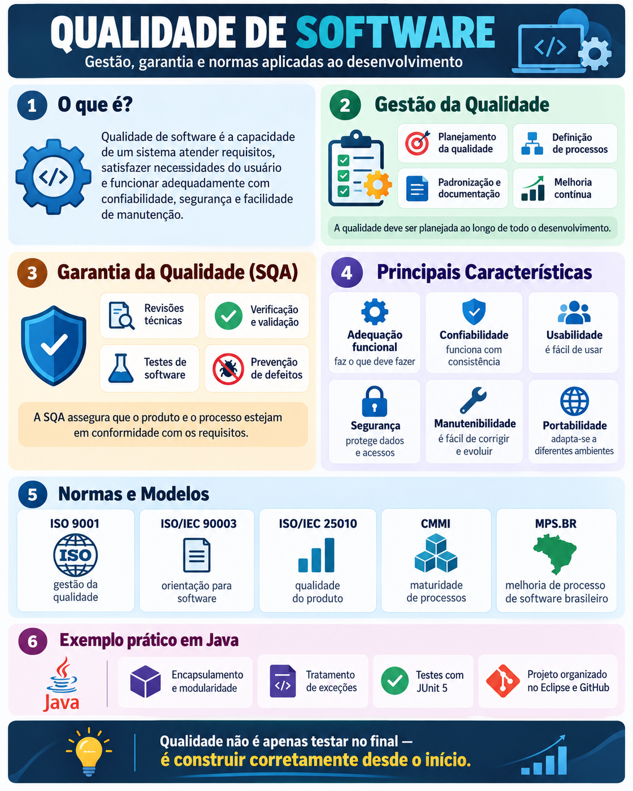

# Biblioteca Qualidade Java

Projeto didático sobre Qualidade de Software, Java, Maven, Eclipse e JUnit 5.

## Infográfico




Projeto didático para aplicar **Programação Orientada a Objetos (POO)** e **Qualidade de Software** em Java, com o **Eclipse IDE**, **Apache Maven** e **JUnit 5**.

O projeto acompanha o material da Unidade 3 de Engenharia de Software e organiza os estudos em três temas:

1. **Gestão da qualidade**: requisitos, padronização, encapsulamento e organização do código.
2. **Garantia da qualidade (SQA)**: validação, tratamento de exceções, revisões e testes automatizados.
3. **Normas e modelos de qualidade**: ISO 9001, ISO/IEC 90003, ISO/IEC 25010, CMMI e MPS.BR.

> **Estado do repositório:** este repositório contém a documentação e o material didático. As classes Java e os testes descritos abaixo devem ser adicionados em `src/` a partir dos exemplos de `latex/material-didatico.tex`. Não há declaração de execução ou aprovação de testes enquanto esses arquivos não estiverem implementados e executados.

## Requisitos

- JDK **17 ou superior** (configurado como compilação para Java 17).
- Apache Maven instalado ou Maven integrado ao Eclipse.
- Eclipse IDE for Java Developers (opcional para execução pelo terminal).
- Acesso à internet no primeiro uso para baixar as dependências do Maven.

## Estrutura do projeto

```text
biblioteca-qualidade-java/
├── src/
│   ├── main/java/br/edu/biblioteca/
│   │   ├── Livro.java
│   │   ├── Usuario.java
│   │   ├── Emprestimo.java
│   │   └── Main.java
│   └── test/java/br/edu/biblioteca/
│       ├── LivroTest.java
│       └── EmprestimoTest.java
├── docs/
│   ├── 01-gestao-qualidade.md
│   ├── 02-garantia-qualidade.md
│   ├── 03-normas-qualidade.md
│   └── relatorio-testes.md
├── latex/
│   └── material-didatico.tex
├── pom.xml
└── README.md
```

**Importante:** `src/` é a organização *prevista* para os arquivos Java. Todos os arquivos `.java` devem começar com `package br.edu.biblioteca;`, conforme os exemplos do material didático. Os testes usam JUnit Jupiter (JUnit 5).

## Principais classes e conceitos

| Arquivo | Objetivo didático |
| --- | --- |
| `Livro.java` | Encapsulamento e controle de disponibilidade, empréstimo e devolução. |
| `Usuario.java` | Atributos privados, construtores e métodos de acesso. |
| `Emprestimo.java` | Validação de prazos e tratamento de entradas inválidas. |
| `Main.java` | Demonstração de criação e uso dos objetos. |
| `LivroTest.java` | Testes de disponibilidade, empréstimo, devolução e título inválido. |
| `EmprestimoTest.java` | Testes de mensagens emitidas para prazos válidos e inválidos. |

Os exemplos são **introdutórios**: ainda não persistem empréstimos, relacionam empréstimos a usuários nem implementam autenticação. O objetivo inicial é estudar propriedades de qualidade do código.

## Importação no Eclipse

1. Abra o Eclipse e selecione **File > Import...**.
2. Escolha **Maven > Existing Maven Projects**.
3. Aponte para a pasta raiz `biblioteca-qualidade-java`, que contém `pom.xml`.
4. Conclua em **Finish**. Se necessário, use **Maven > Update Project**.
5. Adicione ou confira as classes Java nos caminhos indicados acima.
6. Clique com o botão direito em `Main.java` e escolha **Run As > Java Application**.
7. Para os testes, clique em `LivroTest.java` ou `EmprestimoTest.java` e escolha **Run As > JUnit Test**.

## Execução via terminal

Na raiz do projeto:

```bash
java -version
mvn -version
mvn clean test
```

O Maven compila os arquivos Java e executa os testes encontrados em `src/test/java`. Os resultados ficam no console e, após a execução, em `target/surefire-reports/`.

**Atenção:** antes de implementar as classes e os testes, `mvn test` pode terminar sem executar qualquer teste; isso **não** significa que as funcionalidades foram validadas. Confira o total de testes executados.

Os testes de `EmprestimoTest.java` capturam `System.out`, de modo que devem ser executados sem paralelismo. A configuração usa o comportamento sequencial do JUnit; para evolução do projeto, prefira métodos que retornem resultados em vez de imprimir mensagens diretamente nas regras de negócio.

## Documentação

- [01: Gestão da qualidade](docs/01-gestao-qualidade.md)
- [02: Garantia da qualidade](docs/02-garantia-qualidade.md)
- [03: Normas de qualidade](docs/03-normas-qualidade.md)
- [Relatório de testes](docs/relatorio-testes.md)
- [Material didático em LaTeX](latex/material-didatico.tex)

O material em LaTeX contém o resumo das seções, os códigos completos, a estrutura Maven, orientações para Eclipse e atividades para os alunos. O relatório de testes é um **modelo a preencher** depois de executar os testes, não uma certificação de resultados.

## Proposta de atividade

1. Implementar as classes `Livro`, `Usuario`, `Emprestimo` e `Main`.
2. Executar o programa e observar casos válidos e inválidos.
3. Adicionar `LivroTest` e `EmprestimoTest` utilizando JUnit 5.
4. Executar `mvn clean test` e registrar os resultados em `docs/relatorio-testes.md`.
5. Relacionar as evidências obtidas à adequação funcional, confiabilidade, manutenibilidade e testabilidade.
6. Propor melhorias e submeter as alterações por *Pull Request*.

## Referência didática

Unidade 3, **Gerenciamento de qualidade de software**, seções 3.1, 3.2 e 3.3 do livro fornecido para a disciplina. As edições de normas e modelos citadas no material correspondem ao contexto histórico do livro e não devem ser presumidas como as versões mais recentes.

## Licença

A licença de distribuição ainda precisa ser definida pelo responsável pelo repositório. Não presuma que o material do livro original possa ser redistribuído sob uma licença livre.
